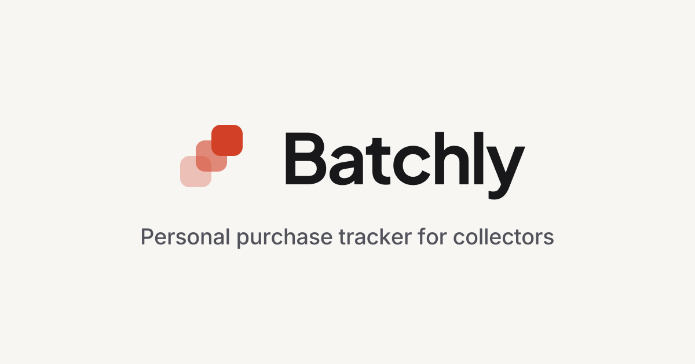
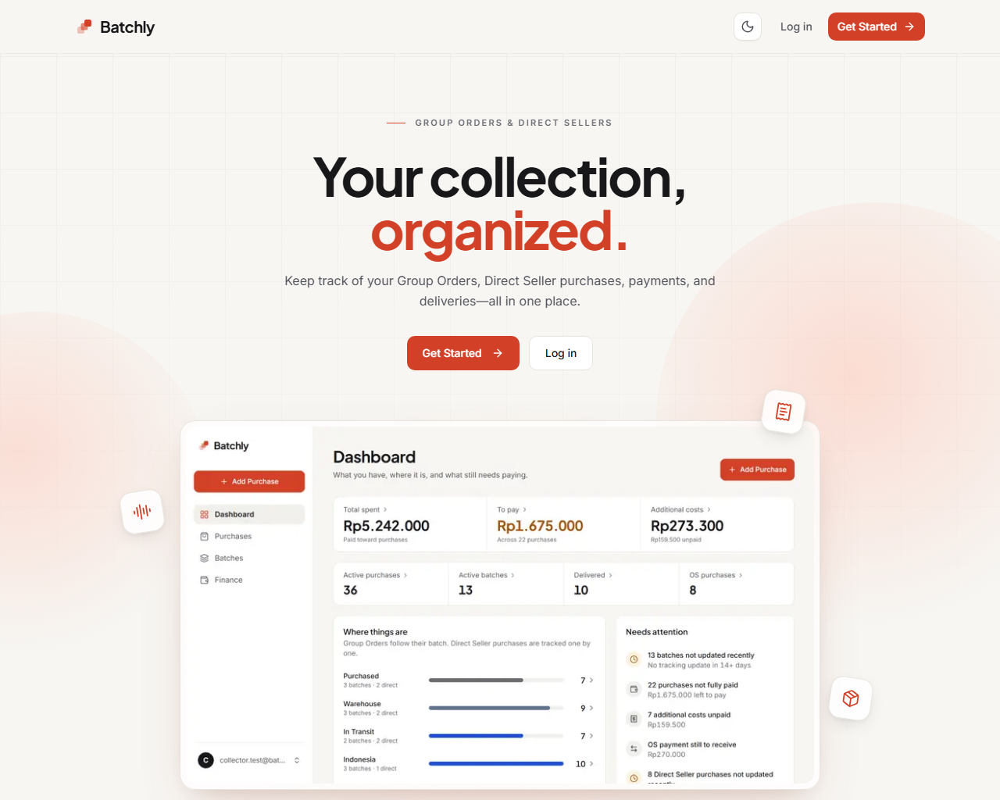
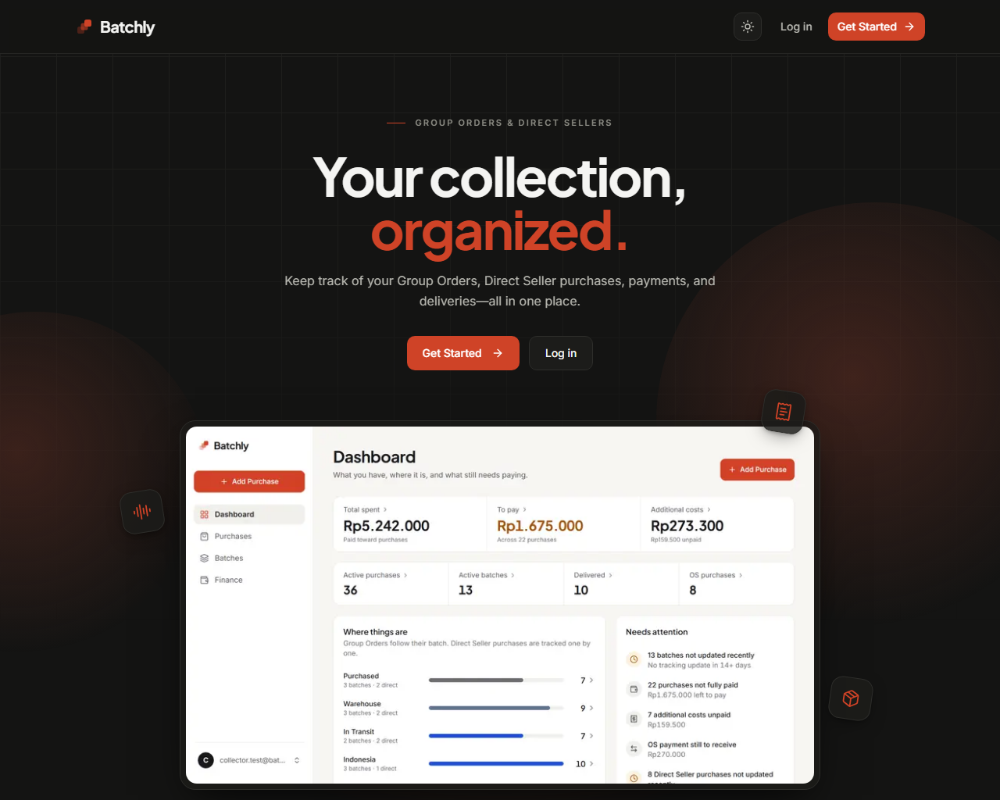

<p align="center">
  
</p>

<h1 align="center">Batchly</h1>

<p align="center">
  A personal purchase and shipment tracker for K-pop collectors.
  <br />
  Keep Group Orders, Direct Seller purchases, payments, tracking, additional costs,
  and OS in one place.
</p>

<p align="center">
  <a href="https://batchly.my.id"><strong>Live app → batchly.my.id</strong></a>
</p>

<p align="center">
  Next.js 16 · React 19 · TypeScript · Tailwind CSS v4 · Supabase
</p>

---

Batchly replaces the spreadsheet-and-chat-history routine with one lightweight place to answer four questions:

- **What did I buy?** Every purchase, organized by source, country, and batch.
- **Where is it?** The current tracking status and the last time it moved.
- **How much have I spent?** Paid, remaining, additional costs, and OS amounts.
- **What needs my attention?** Stale tracking, unpaid balances, and OS payments still to receive.

## Features

### Purchases

- Add a purchase from a **Group Order** or a **Direct Seller** without leaving the flow.
- Record item/member name, artist or group, price, paid amount, purchase date, country, source, notes, and an optional photo.
- Search the list and filter by tab, country, source, tracking status, or payment status; sort by date, price, or last update.
- Archive purchases instead of deleting their history.
- Group Order purchases inherit tracking from their batch. Direct Seller purchases are tracked individually.

### Group Orders and batches

- Organize Group Orders as `Source → Country → Batch → Purchase`.
- Batch pages show the batch status, last update, purchase count, total value, and every purchase inside.
- Updating a batch status updates every purchase in that batch.
- The batch list can be viewed as collapsible Group Order folders or as a flat list.

### Tracking

- Six simple statuses: **Purchased**, **Warehouse**, **In Transit**, **Indonesia**, **Admin Received**, and **Delivered**.
- Statuses can be skipped; they do not have to follow a strict sequence.
- Every trackable item records when its status last changed.
- Anything without an update for **14+ days** is flagged on the batch and purchase lists. “Stale” means no recent update — never that a package is late or lost.

### Payments and additional costs

- Track price, paid amount, and the derived remaining balance.
- Payment status is calculated automatically: **Unpaid**, **Partial**, or **Paid**.
- Record additional costs by type — **Tax**, **Packing**, **Domestic Shipping**, or **Other** — with an amount and paid/unpaid state.
- See outstanding purchase balances and unpaid costs in Finance.

### OS (oper slot)

- **Give OS:** keep the original purchase in history, then record the OS price, amount received, date, and notes.
- **Take OS:** add a purchase that was taken over from someone else, following the same Group Order or Direct Seller flow.
- OS payment status is tracked independently, and **OS Difference** is shown as `OS price − original price` — not as accounting profit.

### Finance and dashboard

- Dashboard shows recently added purchases and a tracking overview with counts for every status.
- Stale batches are flagged in Batches, outstanding balances in Purchases, and unpaid costs and OS amounts in Finance.
- Finance breaks down spending, outstanding balances by payment status, additional costs, and OS amounts.

### The rest

- **Email and password auth** with signup confirmation, password reset, and protected routes.
- **Row Level Security** on every table, so each account can only read and write its own data.
- **Dark mode** with a light default and a saved preference.
- **Installable PWA** with an install action that disappears automatically once the app is installed or opened from the home screen.
- **Responsive layout** with a desktop sidebar and mobile bottom navigation.
- **Share-ready metadata** with Open Graph and Twitter images.

## Product model

```text
GROUP ORDER
Source → Country → Batch → Purchase
                    ↑
        Tracking lives on the batch

DIRECT SELLER
Source → Country → Purchase
                    ↑
        Tracking lives on the purchase
```

A few rules shape the whole app:

- A Group Order source can have batches; a Direct Seller source cannot.
- A batch always belongs to one Group Order source and one country.
- A purchase belongs to exactly one source and one user.
- One purchase represents one trackable item or slot.
- Payment status, remaining amounts, and OS Difference are always derived, never stored.
- The MVP is intentionally manual: no courier APIs, marketplace sync, payment providers, or automatic tracking.

## Tech stack

| Layer           | Choice                                                        |
| --------------- | ------------------------------------------------------------- |
| Framework       | Next.js 16 (App Router, Turbopack)                            |
| UI              | React 19, Tailwind CSS v4, Lucide icons                      |
| Language        | TypeScript                                                    |
| Backend         | Supabase — Postgres, Auth, Storage, Row Level Security        |
| Fonts           | Inter and Plus Jakarta Sans via `next/font`                   |
| Hosting         | Vercel                                                        |
| Quality         | ESLint, `tsc --noEmit`, Node's built-in test runner           |

## A look at the app

<table>
  <tr>
    <td width="50%">
      
    </td>
    <td width="50%">
      
    </td>
  </tr>
  <tr>
    <td align="center"><sub>Light mode</sub></td>
    <td align="center"><sub>Dark mode</sub></td>
  </tr>
</table>

## Getting started

### Prerequisites

- **Node.js 20.9+** (required by Next.js 16)
- **npm**
- A **Supabase** project, or the Supabase CLI for local development

### 1. Install dependencies

```bash
npm install
```

### 2. Configure the environment

Copy `.env.example` to `.env.local` and fill in your Supabase project values:

```dotenv
NEXT_PUBLIC_SUPABASE_URL=https://your-project-ref.supabase.co
NEXT_PUBLIC_SUPABASE_PUBLISHABLE_KEY=sb_publishable_xxx
SITE_URL=http://localhost:3000
```

`SITE_URL` is used as the base for absolute Open Graph and Twitter image URLs. Never put a Supabase service-role or secret key in a `NEXT_PUBLIC_` variable.

### 3. Apply the database migrations

Link the project and push the migrations in `supabase/migrations`:

```bash
npx supabase link --project-ref <your-project-ref>
npx supabase db push
```

Alternatively, run the migration files in order in the Supabase SQL editor. They create:

- the `sources`, `batches`, `purchases`, and `additional_costs` tables;
- enums, constraints, indexes, and rule-enforcement triggers;
- Row Level Security policies and grants;
- the private `purchase-images` Storage bucket and its policies.

### 4. Optional: load development data

`supabase/seed/dev-seed.sql` creates a realistic collection for **one existing, confirmed account**. Edit the email at the top of the file, then run:

```bash
npx supabase db query --linked -f supabase/seed/dev-seed.sql
```

The seed replaces that account's existing data. **Never run it against production.**

### 5. Start the app

```bash
npm run dev
```

Open [http://localhost:3000](http://localhost:3000).

## Scripts

| Command             | Purpose                          |
| ------------------- | -------------------------------- |
| `npm run dev`       | Start the development server     |
| `npm run build`     | Create a production build        |
| `npm run start`     | Serve the production build       |
| `npm run lint`      | Run ESLint                       |
| `npm run typecheck` | Type-check with `tsc --noEmit`   |
| `npm test`          | Run the unit tests               |

Tests cover the pure domain and feature logic: password validation, payment and OS calculations, purchase/batch filtering, batch grouping, and finance summaries.

## Project structure

```text
src/
  app/
    (auth)/              Login, signup, forgot password, reset password
    (app)/               Dashboard, purchases, purchase detail/edit, batches, finance
    auth/confirm/        Supabase email confirmation callback
    layout.tsx           Root layout, metadata, theme bootstrap, providers
    manifest.ts          PWA manifest
  components/
    brand/               Logo and logo mark
    layout/              Sidebar, bottom nav, account menu
    pwa/                 Install state, install button, install dialogs
    theme/               Theme provider and toggle
    ui/                  Buttons, fields, dialogs, cards, toasts, badges
  features/
    auth/                Auth actions and forms
    batches/             Batch queries, filters, grouping, controls
    purchases/           Purchase queries, filters, forms, detail cards
    finance/             Summary calculations and finance cards
    dashboard/           Tracking overview and attention card
    costs/ os/ sources/  Server actions for related records
    tracking/            Status update dialog
    landing/             Public landing page sections
  lib/
    domain.ts            Product vocabulary and derived values
    validation.ts        Shared validation
    supabase/            Browser, server, and proxy clients
supabase/
  migrations/            Schema, RLS, storage, grants
  seed/                  Optional development data
docs/                    PRD, data model, UX spec, design system, test plan
```

## Deployment

The production app runs on **Vercel** at [https://batchly.my.id](https://batchly.my.id).

Before deploying:

1. Set `SITE_URL=https://batchly.my.id` in Vercel's Production environment.
2. Set `NEXT_PUBLIC_SUPABASE_URL` and `NEXT_PUBLIC_SUPABASE_PUBLISHABLE_KEY` to the hosted Supabase project.
3. In Supabase Auth → URL Configuration, set the Site URL to `https://batchly.my.id` and allow:
   - `https://batchly.my.id/auth/confirm`
   - `https://batchly.my.id/auth/confirm?next=/reset-password`
4. Auth emails are delivered through Resend using Supabase's custom SMTP setup as **Batchly `<noreply@batchly.my.id>`**. SMTP credentials belong only in Supabase's dashboard.

The full domain, auth, and smoke-test checklist is in [docs/DEPLOYMENT.md](docs/DEPLOYMENT.md).

## Documentation

The product and implementation rules live in `docs/` and are the source of truth:

| Document                                       | Contents                                             |
| ---------------------------------------------- | ---------------------------------------------------- |
| [PRD](docs/PRD.md)                             | Product scope, domain rules, user stories            |
| [Data model](docs/DATA_MODEL.md)               | Tables, relationships, enums, RLS, calculations      |
| [UX spec](docs/UX_SPEC.md)                     | Navigation, screens, flows, states, responsive rules |
| [Design system](docs/DESIGN_SYSTEM.md)         | Tokens, typography, color, components                |
| [Test plan](docs/TEST_PLAN.md)                 | Verification and acceptance coverage                |
| [Deployment](docs/DEPLOYMENT.md)               | Custom domain, Supabase Auth, email, smoke tests     |

## Scope

Batchly is deliberately an MVP for personal use. It does not integrate with couriers, Group Order admins, WhatsApp, LINE, X, or payment providers, and it is not an accounting or marketplace system. Data entry stays manual so the app remains faster than maintaining a spreadsheet.
